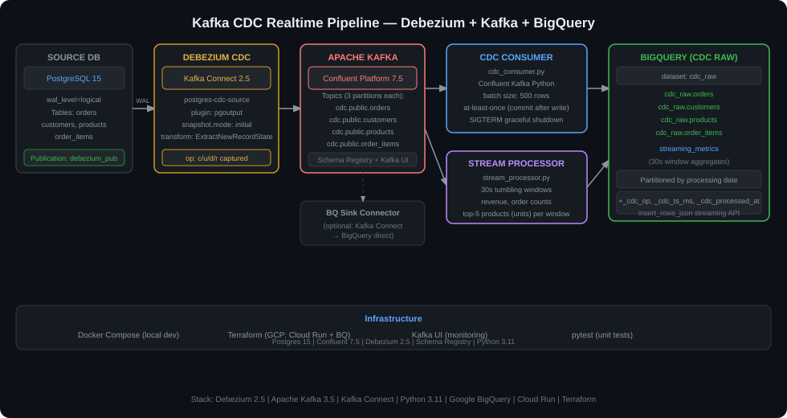

# Kafka CDC Realtime Pipeline


Change Data Capture pipeline that streams every INSERT, UPDATE, and DELETE from a PostgreSQL e-commerce database into a BigQuery change log in near real-time using Debezium, Apache Kafka, and Python consumers (at-least-once), plus 30-second tumbling-window metrics for live dashboards.

## Architecture



## How It Works

```
PostgreSQL (WAL logical replication, publication debezium_pub)
   └── Debezium Kafka Connect (CDC source connector)
         └── Apache Kafka topics  (cdc.public.orders / customers / products / order_items)
               ├── cdc_consumer.py     → BigQuery change log, one table per source table
               └── stream_processor.py → 30s tumbling windows over orders + order_items
                                          → BigQuery streaming_metrics
```

## Key Features

**Debezium CDC Source**
- Reads the PostgreSQL WAL via the `pgoutput` plugin and the `debezium_pub` publication, with no triggers or polling queries on the source tables.
- Captures `c` (create), `u` (update), `d` (delete), and `r` (snapshot read) operations.
- `ExtractNewRecordState` flattens the Debezium envelope and adds `__op`, `__source_table`, `__source_ts_ms` (deletes are rewritten with `__deleted = true` and the last known row values).
- `decimal.handling.mode = double` so NUMERIC columns arrive as numbers; DATE columns (epoch days) are converted to ISO dates by the consumer using the message schema.

**Python CDC Consumer** (`consumers/cdc_consumer.py`)
- Buffers rows per table and flushes all of them when 500 rows are buffered or every 30 s.
- Commits Kafka offsets only after **every** buffered table has been written to BigQuery. A failed write stops the consumer without committing, so the batch is re-read on restart: **at-least-once** delivery.
- Writes a change log: every row carries `_cdc_op`, `_cdc_ts_ms` and `_cdc_processed_at`. The current state of a table is the latest row per primary key where `_cdc_op != 'd'`, which also removes duplicates from redelivery.
- Skips tombstones, handles SIGTERM (flush, then commit), and answers health checks on `$PORT` when deployed to Cloud Run.

**Stream Processor** (`consumers/stream_processor.py`)
- 30-second in-memory tumbling window over `orders` and `order_items`.
- Counts only newly created rows (`op = 'c'`), so updates, deletes and snapshot reads never double-count an order.
- Emits total revenue, order count, revenue by channel and the top-5 products by units sold to `cdc_raw.streaming_metrics`, for live dashboards. The change log stays the source of truth.

**Shared parsing** (`consumers/cdc_events.py`) handles both the flattened format and the raw Debezium envelope and has no Kafka or BigQuery dependency, so it is unit-tested directly (15 tests).

**Optional: managed sink.** `kafka/connectors/bigquery-sink-connector.json` configures the WePay BigQuery sink connector in upsert/delete mode, writing *current-state* tables to a separate dataset (`BQ_SINK_DATASET`). It needs the connector plugin installed in Kafka Connect (`confluent-hub install wepay/kafka-connect-bigquery`), which the default `debezium/connect` image does not include.

## Project Structure

```
kafka-cdc-realtime-pipeline/
├── consumers/
│   ├── cdc_events.py            # Debezium message parsing (pure Python, unit-tested)
│   ├── cdc_consumer.py          # CDC change log → BigQuery (at-least-once)
│   └── stream_processor.py      # 30s tumbling-window metrics
├── kafka/
│   └── connectors/
│       ├── postgres-cdc-connector.json   # Debezium source config
│       └── bigquery-sink-connector.json  # Optional WePay sink (current-state tables)
├── docker/
│   ├── docker-compose.yml       # Postgres, Kafka, Connect, Kafka UI, both consumers
│   ├── Dockerfile
│   └── init.sql                 # Postgres schema + CDC publication
├── terraform/
│   └── main.tf                  # BQ dataset + tables, Cloud Run consumer, IAM, secret
├── tests/
│   ├── test_cdc_consumer.py
│   └── test_stream_processor.py
├── snapshots/
│   └── architecture.svg
├── .env.example
└── requirements.txt
```

## Quick Start

```bash
# 1. Clone + install
git clone https://github.com/jaiminbabariya7/kafka-cdc-realtime-pipeline.git
cd kafka-cdc-realtime-pipeline
pip install -r requirements.txt

# 2. Configure environment
cp .env.example .env  # Fill in credentials

# 3. Start the full local stack (Postgres, Kafka, Connect, Kafka UI and both consumers)
docker compose -f docker/docker-compose.yml --env-file .env up -d

# 4. Register the Debezium connector (wait ~30s for Kafka Connect to start)
curl -X POST http://localhost:8083/connectors \
  -H "Content-Type: application/json" \
  -d @kafka/connectors/postgres-cdc-connector.json

# 5. Insert, update or delete rows in Postgres and watch them land in BigQuery;
#    Kafka UI runs on http://localhost:8080
#    (to run a consumer outside Docker instead: set -a; . ./.env; set +a
#     then python consumers/cdc_consumer.py)

# 6. Run tests
pytest tests/ -v --cov=consumers

# 7. Deploy to GCP (BigQuery tables, Cloud Run consumer, IAM)
cd terraform && terraform init && terraform apply -var="project_id=$GCP_PROJECT_ID"
```

## Tech Stack

| Component | Technology |
|---|---|
| CDC Source | Debezium 2.5 (PostgreSQL connector) |
| Message Broker | Apache Kafka 3.5 (Confluent Platform) |
| Consumers | Python 3.11 + confluent-kafka |
| Sink | Google BigQuery (streaming insert API) |
| Infrastructure | Terraform (BigQuery, Cloud Run, IAM, Secret Manager) |
| Local Dev | Docker Compose |
| Testing | pytest |
| Monitoring | Kafka UI |